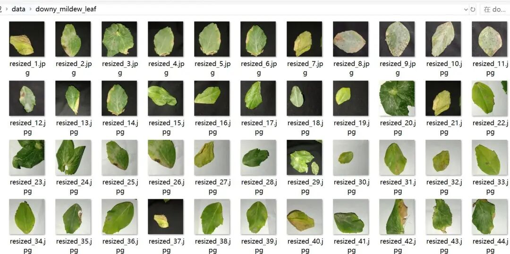
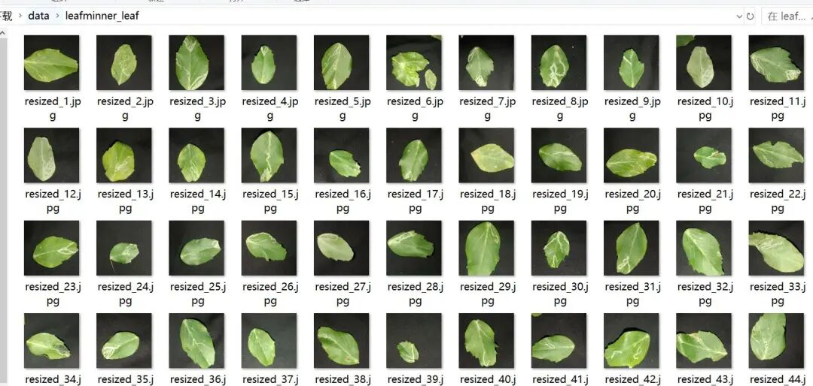
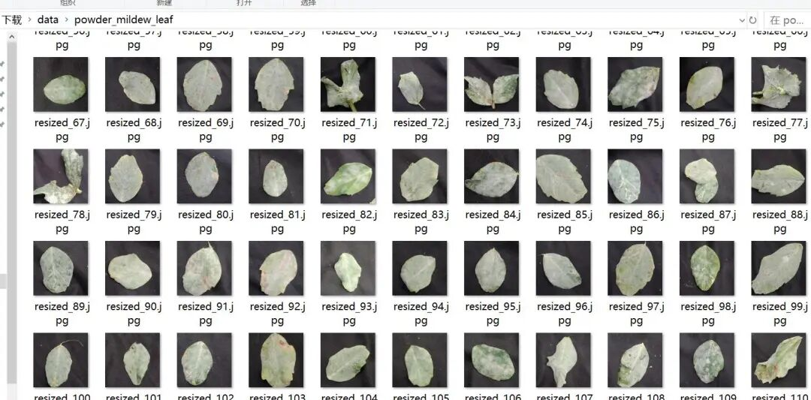

# Pea Leaf Disease and Pest Image Classification Dataset: 1432 Images in 4 Categories

Dataset type: Image classification, not for object detection without annotations.

Dataset format: Only contains jpg images, each category folder contains the corresponding image.

Number of images (number of jpg files): 1432

Category: 4

Category Name: ["downy_mildew_leaf", "fresh_leaf", "leafminner_leaf", "powder_mildew_leaf"]

Number of images per category:

Downy mildew leaf (photos: 366)

fresh_leaf (fresh leaf) 411 images

leafminner_leaf (leaf of leafminer) 348 images

powder_mildew_leaf (White Powdery Mildew Leaf Pictures: 307

Image resolution: 256x256

Important Notice: No

Special : This dataset does not guarantee the accuracy of the trained models or weight files, and it only provides accurate and reasonable classification storage.

Image Preview:

Dataset address:

## Payment

Here is a pay link on Stripe ( https://buy.stripe.com/3cs8yP7sY87d0vu9AB ). Please contact me lonlonago@foxmail.com after funding $89, and I will send you a complete data files , thank you!

